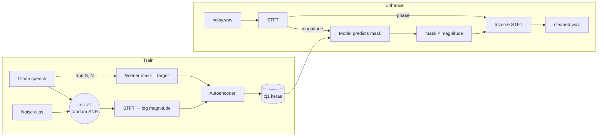

# CJ1: Intelligent Noise Reduction & Speech Enhancement

CJ1 learns to remove background noise from speech. You give it a noisy voice recording and it returns the voice with the noise filtered out. Café chatter, traffic, white noise and mains hum are the target cases.

The repo has two parts:

| File | What it is |
|---|---|
| `signal-path.html` | An interactive explainer. Open it in a browser to watch one noisy clip move through every stage of the system, computed live. |
| `denoise.py` | The real thing. It trains the Keras model and uses it to clean audio files. |

## The concept

### 1. The problem

A microphone records the sum of everything it hears:

```
y(t) = s(t) + n(t)        recording = clean speech + noise
```

We only ever get `y`. The goal is to recover `s` from `y` alone.

### 2. Why we work in frequency, not time

In the raw waveform, voice and noise are tangled together. The **Short-Time Fourier Transform (STFT)** fixes that. It cuts the clip into short overlapping frames (512 samples = 32 ms, Hann window, hop of 128 samples) and turns each frame into its frequencies. The result is a time × frequency grid, or spectrogram, where speech and noise mostly land in *different cells*:

- Speech shows up as a comb of harmonics (the pitch, around 120 Hz apart) that moves over time, with most of its energy between 300 and 3400 Hz.
- Broadband noise raises the floor everywhere. Hum shows up as sharp, steady lines.

### 3. Magnitude in, phase kept

Each STFT cell is a complex number. Its **magnitude** says how loud that frequency is, and its **phase** says where in its cycle the tone sits. Noise is easy to see in the magnitude and almost impossible to model in the phase, so the network only looks at the magnitude. The noisy phase is stored and reattached at the end.

### 4. The mask: deciding which cells are speech

For every cell, a gain between 0 and 1 says how much of that cell to keep:

```
M = |S|² / (|S|² + |N|²)        the "ideal" (Wiener) mask
|Ŝ| = M · |Y|                   cleaned magnitude
```

A cell that is mostly voice gets a gain near 1 and a cell that is mostly noise gets a gain near 0. The catch is that computing `M` needs the clean speech `S` and the noise `N`, which a real recording doesn't give you.

### 5. The model learns the mask

That's the job of the **denoising autoencoder**. During training we *build* noisy recordings ourselves by mixing clean speech with noise at a random loudness, so we know `S` and `N` and can compute the true mask. The network sees only the noisy magnitude and learns to predict that mask. After training it predicts `M̂` from a noisy recording alone.

```
input   log|Y| of one frame + 5 frames either side   (11 × 257 values, ~0.2 s of context)
        → Normalise → Dense 1024 → Dense 256 (bottleneck) → Dense 1024
output  257 gains in [0, 1], one per frequency bin    (sigmoid)
loss    mean squared error against the true Wiener mask
```

### 6. Back to sound

The cleaned magnitude is paired with the stored noisy phase. An inverse STFT with overlap-add then turns the grid back into a waveform you can play.

## Workflow



### 1. Set up

You need **native** Python 3.10 to 3.12. On Apple Silicon, use Homebrew's Python, not an Intel Anaconda build: TensorFlow refuses to run under emulation.

```bash
python3 -m venv .venv
.venv/bin/pip install -r requirements.txt
```

### 2. Check that everything works (no data needed)

```bash
.venv/bin/python denoise.py demo
```

This command does three things:

1. It trains for about a minute on synthetic voices and noise.
2. It cleans a clip the model hasn't seen.
3. It fails if the SNR doesn't improve by at least 3 dB.

A typical result is `SNR 0.0 dB → 12.8 dB`.

### 3. Get training data

Make two folders of `.wav` or `.flac` files. Subfolders are fine, any sample rate works, and stereo is mixed down to mono.

```
data/clean/   speech only, e.g. LibriSpeech dev-clean (~340 MB)
data/noise/   noise only, e.g. DEMAND or ESC-50, or your own café/traffic/hum recordings
```

Real voices are what make the model useful. The synthetic demo data only proves the pipeline works.

### 4. Train

```bash
.venv/bin/python denoise.py train --clean data/clean --noise data/noise --out cj1.keras
```

- `--clips 2000` sets how many random 2-second noisy mixtures to generate. More clips means a better model and more memory.
- `--epochs 30` is the upper limit. Training stops early once the validation loss stops improving.

### 5. Clean a recording

```bash
.venv/bin/python denoise.py enhance noisy.wav cleaned.wav --model cj1.keras
```

The output is 16 kHz mono.

### 6. Explore the pipeline visually

Open `signal-path.html` in any browser. You can pick a noise type, drag the SNR slider, change the window size, scan the STFT frame by frame, and play the noisy, enhanced and clean audio. The page uses the ideal mask, so it shows the best result this approach can reach. The trained model aims to get close to it.

## Known limits

- **Noisy phase.** Reusing the noisy phase caps quality at very low SNR. A phase-aware model or complex masks is the next step.
- **No real-time streaming.** Each frame needs 5 future frames (about 40 ms of look-ahead), and the script works on whole files.
- **Training data held in memory.** Very large datasets will need a `tf.data` pipeline instead.
- **Not evaluated on real speech.** It has only been checked on synthetic data. Add PESQ and STOI scores on a held-out set once you've trained on real speech.

## Project layout

```
denoise.py         training, enhancement and the self-check
signal-path.html   interactive explainer (single file, no build step)
requirements.txt   Python dependencies
```
